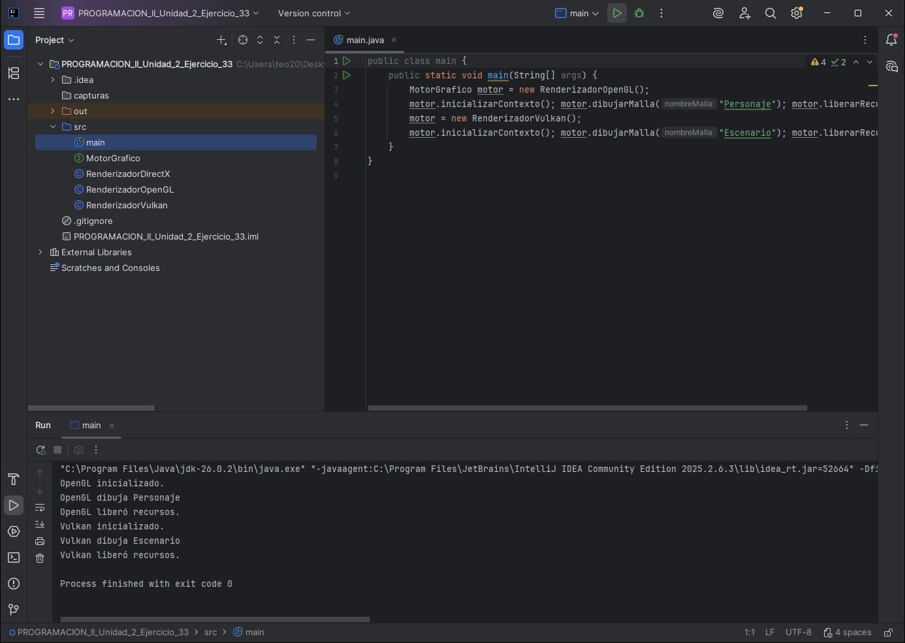

# PROGRAMACIÓN II — Unidad 2, Ejercicio 33: El Sistema de Motores de Renderizado Gráfico

Trabajo práctico de Programación II. Este repositorio contiene la resolución en Java del ejercicio 33 de la Unidad 2.

## Consigna

#### Contexto

En el desarrollo de un motor de videojuegos multiplataforma, las escenas deben renderizarse utilizando diferentes tecnologías gráficas subyacentes (como DirectX, OpenGL o Vulkan). Gracias a la abstracción, las entidades del juego envían órdenes genéricas de dibujo sin conocer las llamadas específicas al sistema de video.

#### Consigna

Construir una solución en Java donde el sistema gráfico principal utilice una interfaz abstracta para comandar motores de renderizado de manera modular.

#### Desarrollo requerido

- Definir una interfaz MotorGrafico con métodos abstractos como inicializarContexto(), dibujarMalla(String nombreMalla) y liberarRecursos().
- Desarrollar clases concretas que implementen dicha interfaz, tales como RenderizadorOpenGL, RenderizadorDirectX y RenderizadorVulkan.
- Agregar validaciones de estado en los métodos (por ejemplo, verificar que el contexto esté inicializado antes de intentar dibujar).
- En el método main, simular la ejecución de un ciclo gráfico intercambiando el motor de renderizado mediante una variable de tipo interfaz y reflejar el resultado por consola.

## Estructura del repositorio

```
PROGRAMACION_II_Unidad_2_Ejercicio_33/
├── README.md
├── capturas/
│   └── consola.png
└── src/
    ├── main.java   # clase con el método main
    ├── MotorGrafico.java
    ├── RenderizadorDirectX.java
    ├── RenderizadorOpenGL.java
    └── RenderizadorVulkan.java
```

## Funcionamiento y lógica

El ejercicio usa una **interfaz** para que un juego pueda dibujar con distintos motores gráficos de la misma forma.

### `MotorGrafico` (interfaz)

Define tres operaciones: `inicializarContexto()`, `dibujarMalla(String)` y `liberarRecursos()`.

### `RenderizadorOpenGL`, `RenderizadorVulkan` y `RenderizadorDirectX`

Implementan la interfaz y guardan si el contexto está iniciado (`iniciado`):

- **`inicializarContexto()`:** marca el motor como iniciado.
- **`dibujarMalla()`:** solo dibuja si el contexto está iniciado; si no, pide inicializarlo primero.
- **`liberarRecursos()`:** vuelve a dejar el motor sin iniciar.

Cada uno muestra mensajes con el nombre de su tecnología.

### `main`

Usa una variable de tipo `MotorGrafico`: primero con **OpenGL** dibuja un "Personaje" y después con **Vulkan** dibuja un "Escenario". En cada caso hace la secuencia completa: inicializar → dibujar → liberar.

## Ejecución

Captura de la consola de IntelliJ IDEA ejecutando el programa:



Salida obtenida:

```
OpenGL inicializado.
OpenGL dibuja Personaje
OpenGL liberó recursos.
Vulkan inicializado.
Vulkan dibuja Escenario
Vulkan liberó recursos.
```
